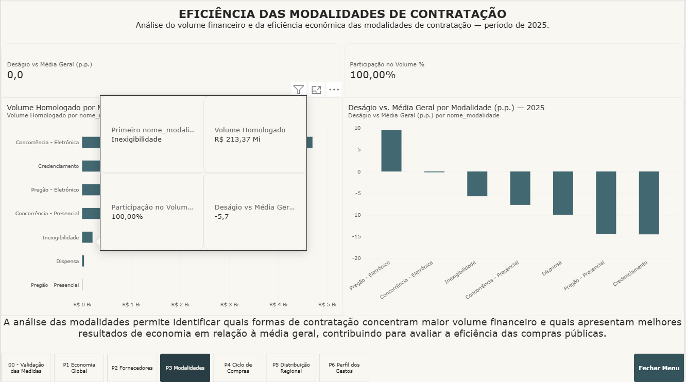
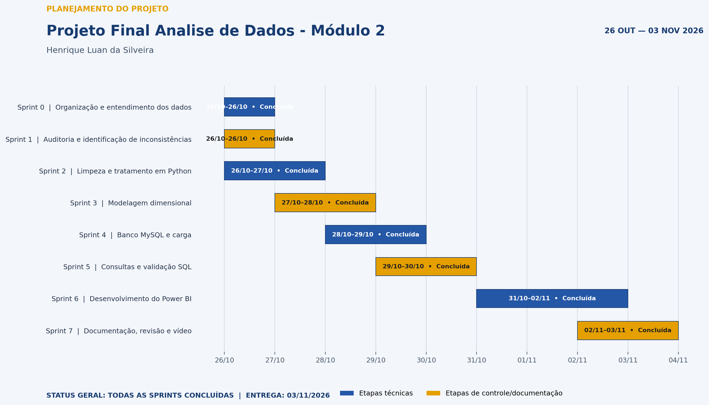

# Inteligência nas Contratações Públicas

### Análise de dados do PNCP \| Projeto Avaliativo -- Módulo 2

**Autor:** Henrique Luan da Silveira\
**Período de desenvolvimento:** 26/10/2026 a 03/11/2026\
**Fonte:** Portal Nacional de Contratações Públicas (PNCP) -- dados
fornecidos para o projeto\
**Ano analisado:** 2025

------------------------------------------------------------------------

## 1. Apresentação

O projeto **Inteligência nas Contratações Públicas** tem como finalidade
estruturar uma solução analítica para apoiar a Controladoria na
avaliação das compras governamentais.

A aplicação transforma arquivos de licitações e itens contratados do
PNCP em uma base tratada, relacional e pronta para análise. O trabalho
integra processamento com Python, armazenamento no MySQL e visualização
executiva no Power BI.

A proposta é permitir que os dados sejam analisados sob diferentes
perspectivas: economia, fornecedores, modalidades, duração dos
processos, distribuição geográfica e perfil dos gastos.

## 2. Visão técnica da solução

A arquitetura foi organizada em quatro camadas:

1.  **Origem:** arquivos CSV do PNCP disponibilizados no material do
    projeto.
2.  **Preparação:** auditoria, padronização e transformação com Python e
    pandas.
3.  **Persistência:** modelo dimensional em estrela no MySQL.
4.  **Consumo:** consultas SQL, medidas DAX e dashboard no Power BI.

``` text
Arquivos PNCP
     │
     ▼
Python / pandas
Auditoria e tratamento
     │
     ▼
MySQL
Star Schema
     │
     ▼
Power BI
Indicadores e análises
```

### Ferramentas

-   Python e pandas para tratamento dos dados.
-   MySQL Server e MySQL Workbench para banco de dados e consultas.
-   Power BI Desktop e DAX para modelagem analítica e visualizações.
-   Git e GitHub para versionamento e disponibilização do código.

## 3. Base utilizada

A solução utiliza a base fornecida pelo professor, originada do Portal
Nacional de Contratações Públicas, com dados referentes ao período de
02/01/2025 a 31/12/2025.

O escopo integra dados dos cabeçalhos dos certames e dos itens
contratados, permitindo relacionar órgãos, datas, modalidades,
fornecedores, localidades, quantidades e valores.

## 4. Auditoria, limpeza e regras adotadas

O tratamento contempla cinco grupos principais de inconsistências:

  -----------------------------------------------------------------------
  Categoria                           Procedimento
  ----------------------------------- -----------------------------------
  Identificadores                     Padronizar documentos, preservar
                                      zeros à esquerda e tratar
                                      diferenças entre tipos de pessoa.

  Dados monetários                    Interpretar valores com símbolos,
                                      separadores variados, espaços e
                                      negativos entre parênteses.

  Datas                               Uniformizar formatos e verificar a
                                      sequência cronológica dos eventos.

  Nulos disfarçados                   Tratar marcadores textuais de
                                      ausência sem converter zeros
                                      numéricos válidos em nulos.

  Textos                              Corrigir problemas de codificação e
                                      padronizar nomes e descrições.
  -----------------------------------------------------------------------

### Regras de negócio implementadas

-   Uma linha da tabela fato representa um item de contratação,
    identificado por `numero_controle_pncp` e `numero_item`.
-   Os cálculos de economia consideram apenas itens comparáveis.
-   Os percentuais são obtidos por meio da razão entre somatórios.
-   Divisões com denominador zero são protegidas.
-   A concentração de fornecedores é analisada pelo volume homologado.
-   O tempo de ciclo considera publicação e homologação, respeitando as
    regras de validade temporal.
-   A classificação do perfil de gasto é mantida na tabela fato.

Os quantitativos da auditoria devem refletir a execução real dos
scripts. Preencha aqui os números efetivamente obtidos para cada grupo
de inconsistência, sem utilizar valores estimados.

## 5. Banco de dados e modelo dimensional

A camada analítica foi organizada em modelo estrela (*Star Schema*),
composto por:

  -----------------------------------------------------------------------
  Tabela                              Responsabilidade
  ----------------------------------- -----------------------------------
  `fato_item_contratado`              Registrar os itens e seus valores,
                                      quantidades e indicadores.

  `dim_orgao`                         Descrever os órgãos responsáveis
                                      pelas contratações.

  `dim_fornecedor`                    Identificar os fornecedores.

  `dim_modalidade`                    Descrever as modalidades de
                                      contratação.

  `dim_localidade`                    Organizar informações geográficas.
  -----------------------------------------------------------------------

As dimensões se conectam à fato por chaves substitutas, com
relacionamentos e integridade referencial.

No Power BI, o calendário é criado com DAX e possui atributos de ano,
mês, trimestre e ordenação temporal. A hierarquia automática de datas
não deve ser utilizada.

**Diagrama da modelagem:**\


> Inclua a captura real do modelo com o nome `modelo_estrela.png` na
> pasta `docs/img/`. Se não for incluí-la, retire a referência acima.

## 6. Análises de negócio no Power BI

O dashboard foi estruturado para responder às seis perguntas
estratégicas definidas no enunciado:

  -----------------------------------------------------------------------
  Página                  Indicador estratégico   Objetivo
  ----------------------- ----------------------- -----------------------
  P1 -- Economia Global   Economia nominal e      Avaliar a diferença
                          percentual              entre valores estimados
                                                  e homologados.

  P2 -- Fornecedores      Ranking e concentração  Identificar os maiores
                                                  fornecedores e a
                                                  participação no volume
                                                  financeiro.

  P3 -- Modalidades       Volume e deságio        Comparar modalidades
                                                  quanto ao volume
                                                  contratado e à
                                                  economia.

  P4 -- Ciclo de Compras  Duração dos processos   Identificar órgãos com
                                                  maiores tempos entre
                                                  publicação e
                                                  homologação.

  P5 -- Distribuição      Volume e economia por   Comparar estados e
  Regional                localidade              regiões.

  P6 -- Perfil dos Gastos Bens, serviços e        Analisar como os
                          obras/engenharia        recursos são
                                                  distribuídos por
                                                  perfil.
  -----------------------------------------------------------------------

O relatório reúne cartões de indicadores, gráficos de comparação e
distribuição, detalhamento tabular, navegação entre páginas, indicadores
visuais e tooltip personalizado.

A tabela dedicada de medidas contém pelo menos 15 medidas DAX
explícitas, utilizadas nas visualizações e respostas do dashboard.

**Imagem do dashboard:**\


> Adicione uma captura real do relatório com esse nome em `docs/img/` ou
> remova a referência caso a imagem não esteja disponível.

## 7. Organização do repositório

``` text
Projeto_Final_Analise_Dados/
├── README.md
├── data/
│   ├── raw/
│   └── processed/
├── src/
│   ├── __init__.py
│   ├── limpeza.py
│   ├── montar_tabelas.py
│   └── carregar.py
├── sql/
│   ├── 01_criar_banco.sql
│   └── 02_perguntas.sql
├── powerbi/
│   └── dashboard_compras_publicas.pbix
└── docs/
    └── img/
        ├── sprints.png
        ├── modelo_estrela.png
        └── dashboard_economia.png
```

A estrutura deve ser ajustada aos nomes efetivos dos arquivos do
repositório. Os dados originais devem permanecer organizados em
`data/raw/`, conforme o kit. Não devem ser publicados dados de conexão,
senhas ou credenciais.

## 8. Instruções para reprodução

### Requisitos

-   Python e bibliotecas utilizadas pelo projeto.
-   MySQL Server e MySQL Workbench.
-   Power BI Desktop.

### Execução do pipeline

**1. Obter o repositório**

``` bash
git clone <URL_DO_REPOSITORIO>
cd <PASTA_DO_PROJETO>
```

**2. Preparar o ambiente Python**

``` bash
python -m venv .venv
```

Instalar as dependências, caso exista um arquivo `requirements.txt`:

``` bash
pip install -r requirements.txt
```

**3. Executar a limpeza e os testes**

``` bash
python -m src.limpeza
```

**4. Gerar as tabelas preparadas**

``` bash
python -m src.montar_tabelas
```

**5. Criar o banco de dados**

Executar o arquivo `sql/01_criar_banco.sql` no MySQL Workbench.

**6. Carregar os dados**

Configurar a conexão MySQL de acordo com os parâmetros do projeto e
executar:

``` bash
python -m src.carregar
```

**7. Conferir as consultas**

Executar o conteúdo de `sql/02_perguntas.sql` no MySQL Workbench e
comparar os resultados com os indicadores do Power BI.

**8. Abrir o dashboard**

Abrir o arquivo `.pbix` na pasta `powerbi/`, ajustar a conexão ao banco
local, se necessário, e atualizar os dados.

> A reprodução deve utilizar os nomes e comandos efetivamente presentes
> no repositório. Nunca inclua senhas ou credenciais no README.

## 9. Planejamento das Sprints

O trabalho foi organizado em etapas incrementais, com objetivos e
entregas verificáveis, desde a compreensão dos arquivos brutos até a
documentação e apresentação técnica.



**Período:** 26/10/2026 a 03/11/2026.

## 10. Evoluções possíveis

Como continuidade da solução, podem ser consideradas:

-   Automatizar a atualização periódica da base.
-   Incluir indicadores adicionais de competitividade.
-   Acompanhar variações de desempenho por órgão e modalidade.
-   Ampliar os mecanismos de auditoria e rastreabilidade dos dados.
-   Evoluir os recursos de exploração e detalhamento do dashboard.

## 11. Vídeo de apresentação técnica

**Defesa técnica:** \[Inserir link público do Google Drive\]

A apresentação demonstra a execução do pipeline, os critérios de
limpeza, a arquitetura do banco, as consultas SQL, as medidas e
visualizações do Power BI, o planejamento das Sprints e as oportunidades
de evolução.

------------------------------------------------------------------------

**Autor:** Henrique Luan da Silveira\
**Projeto Avaliativo -- Análise de Dados com Python \| Módulo 2**\
**2026**
